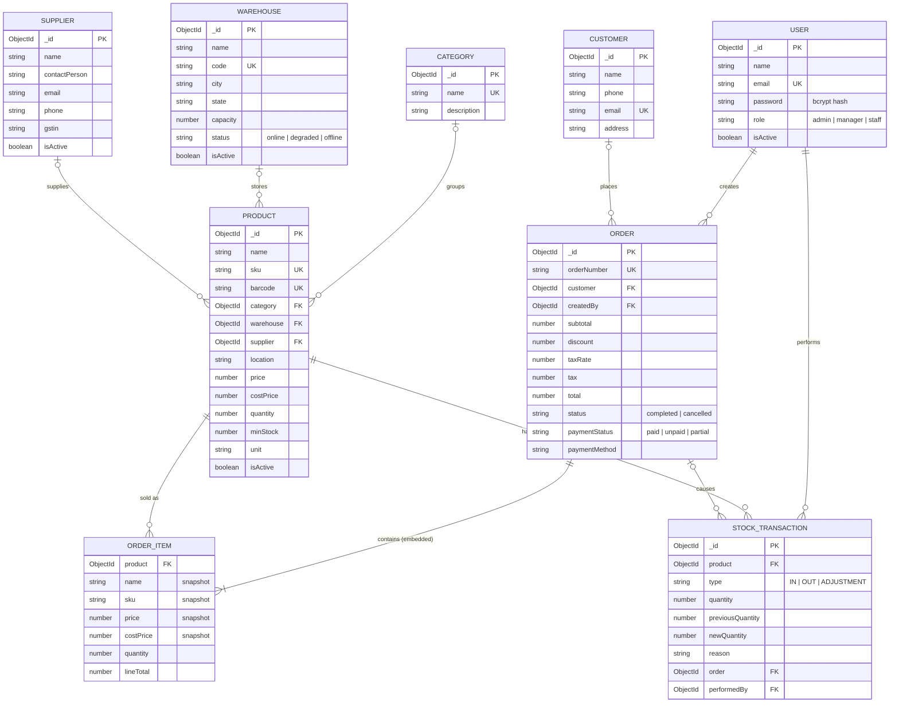

# Database Structure (ER Diagram)

Database: **MongoDB** (Atlas), accessed through **Mongoose**. Collections: `users`, `categories`, `warehouses`, `suppliers`, `products`, `customers`, `orders`, `stocktransactions`.

## Design notes

- **Order items are embedded** in the order and store a snapshot of the product name, SKU, price and cost, so old invoices stay correct if a product changes later.
- **`products.quantity` is the live stock.** Every change also writes a `stocktransactions` row (previous and new quantity, reason, who did it), so there is a full audit trail.
- **Stock updates are atomic** (`$inc` with a `quantity >= n` filter), so two simultaneous requests can never oversell or push stock below zero.
- **Soft deletes:** products, warehouses and suppliers are deactivated (`isActive: false`) instead of removed, so history is never broken.
- **Indexes:** unique on `email`, `sku`, `barcode` (sparse), `orderNumber`, warehouse `code`; compound indexes on stock history and orders by date.
- You can view this diagram as an image by pasting the code above into https://mermaid.live and exporting PNG.
